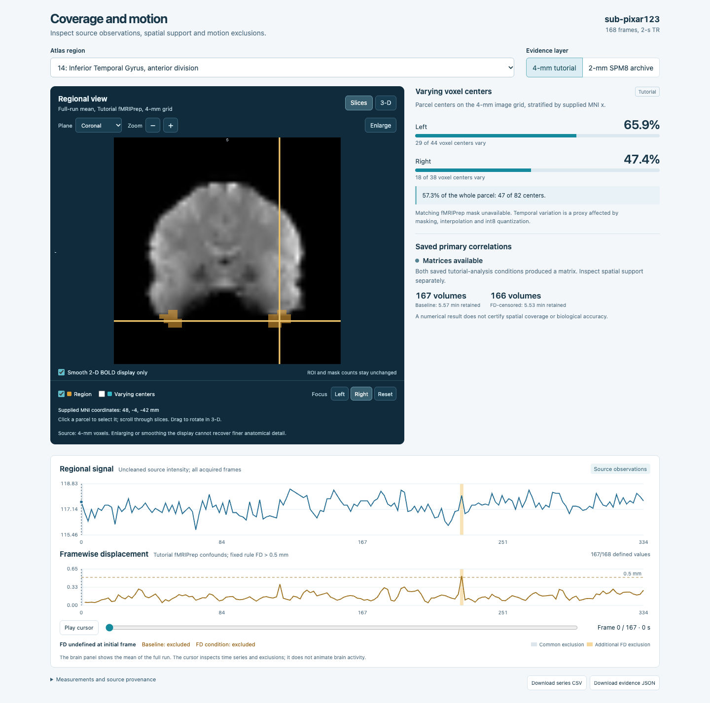
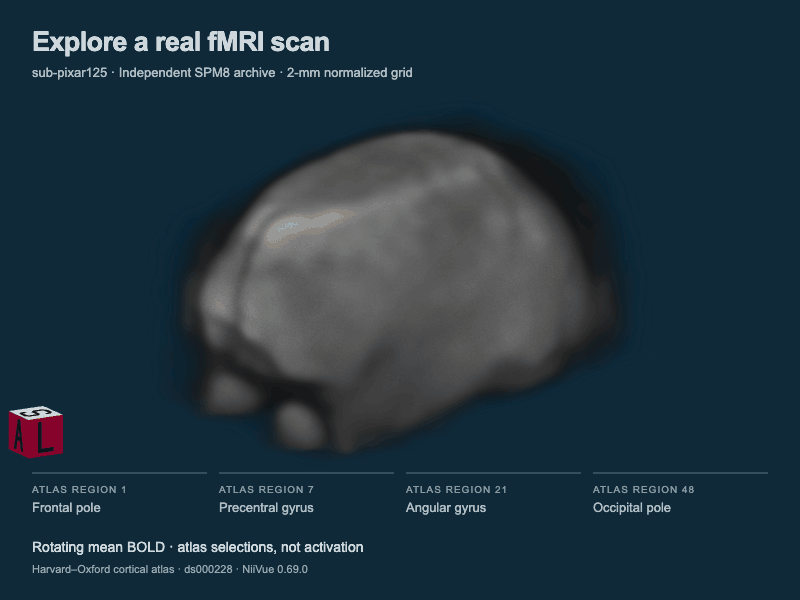

# fMRI Quality Explorer

**[Open the interactive demo →](https://esanchezharris.github.io/fmri-quality-explorer/)**
Explore all eight participants in your browser, rotate the brain, inspect atlas regions,
and download saved observations. No installation or account required.

I checked eight public fMRI scans (adults watching a short Pixar film) before
analyzing them. One scan produced a completely flat signal in a temporal-lobe region. Tracing it
back showed an independent brain mask for that scan contained none of the region. Checking all eight
participants turned up a second scan, sub-pixar123, whose results looked normal but whose mask
covered only 26% and 8% of two nearby regions. A published reanalysis of the same dataset
excluded both participants for poor coverage. The lesson: a result the software can compute is
not necessarily a result you can trust.

A reproducible Python workflow and Streamlit app for reviewing public movie-watching
fMRI data from eight adults. It inventories scans, checks data integrity, investigates
brain coverage and motion, and compares regional correlations under one fixed motion rule.
Reports and exports retain source identities, original frame indices, exclusions and
explicitly unavailable results.





The 12-second loop shows sub-pixar125's independent SPM8 mean BOLD and four atlas parcels.
The normalized 2-mm grid already has 5-mm smoothing; the color is an atlas selection,
not an activation result. Harvard–Oxford atlas adaptation and GIF: [CC BY-SA 4.0](https://creativecommons.org/licenses/by-sa/4.0/).

The hosted edition is a browser-only viewer of verified saved artifacts. The complete
Python/Streamlit workflow is reproduced below. [Hosting and animation details](docs/HOSTED_DEMO.md).

## What the data revealed

- **A calculation can succeed despite limited coverage.** Sub-pixar123 produced correlation
  matrices, but the independent archived mask covered only 171/647 atlas centers in region
  14 and 50/610 in region 37. The latter split was 49/316 left versus 1/294 right.
- **An invalid result stays unavailable.** Sub-pixar124's tutorial region 14 was constant.
  Its matrices were withheld, while its inventory, motion, retained data and observed
  evidence remained visible. Seven of eight participants yielded paired matrices.
- **Different evidence needs different denominators.** Tutorial temporal variation is a
  proxy on the 4-mm image grid. The independent SPM8 mask uses every center in the original
  2-mm atlas parcel. The matching 2019 fMRIPrep parent mask and QA remain unavailable.

Read the [saved findings and CSV definitions](examples/README.md),
[coverage case study](investigations/eight-adult-coverage/PORTFOLIO_CASE_STUDY.md),
[scientific methods](docs/METHODS.md), and [viewer controls](docs/COVERAGE_EXPLORER.md).
The [self-contained HTML findings report](examples/report.html) can be downloaded and
opened locally. These are recorded real-data findings, not synthetic observations.

## Reproduce the primary analysis

Requires Python 3.12 and [uv](https://docs.astral.sh/uv/). Initial acquisition needs internet
access. Process scans sequentially and preserve the one-participant checkpoint:

```sh
git clone https://github.com/esanchezharris/fmri-quality-explorer.git
cd fmri-quality-explorer
uv sync --locked
uv run pytest -q
uv run python -m fmri_study_check run --n-subjects 1 --output-dir outputs/one
uv run python -m fmri_study_check verify outputs/one
uv run python -m fmri_study_check fixture --source-bundle outputs/one
uv run python -m fmri_study_check run --n-subjects 8 --output-dir outputs/eight --checkpoint outputs/one
uv run python -m fmri_study_check verify outputs/eight
uv run streamlit run app.py --server.headless true
```

The recorded eight-adult run returns **partial status / exit code 1** because sub-pixar124
has an unavailable matrix, while preserving the successful participants and all reports.
That is the expected documented finding for the recorded sources. Inspect specific
failures on a new run; do not replace participants, trim mismatched files or fabricate data.

## Prepare the interactive coverage views

The primary workflow enables Overview, Scan Inspection, Analysis Comparison and Report.
The separate coverage supplement and linked viewer additionally require independent public
archive downloads and hemisphere measurements. After completing the primary stages:

```sh
# Without --run, this prints the preparation plan and performs no acquisition.
uv run python tools/bootstrap_supplements.py
uv run python tools/bootstrap_supplements.py --run
uv run streamlit run app.py --server.headless true
```

Supplementary acquisition can require about 1 GB. The bootstrap creates fresh local
preservation snapshots once, verifies existing completed supplements, refuses stale
protection records, and prepares content-based display caches. It does not reset a guard
or rewrite completed investigations to make a failure pass. UI interactions read completed
artifacts and do not download, extract, clean or calculate correlations.

## Fixed comparison and interpretation

Harvard–Oxford `cort-maxprob-thr25-2mm`, without hemisphere splitting. Nuisance regression
uses six motion parameters, white-matter/CSF means and the supplied cosine drift columns.
Both conditions exclude original frame zero and supplied non-steady-state frames. The
comparison adds only **FD > 0.5 mm** censoring through supported original-index sample masks.
The estimator is ordinary Pearson correlation. Matrix ordering and scales stay fixed.

Project guardrails require 120 retained seconds and 20 nominal residual design degrees
of freedom. These are not validated adequacy criteria. Coverage measurements and matrix
changes do not prove biological accuracy. This is a small descriptive demonstration;
no clinical conclusions or population inference are made. Unknown mask values remain
unknown, and independent preprocessing lineages are never treated as the same parent data.

The tutorial image has 4-mm voxels. The independent archive has a 2-mm normalized grid and
prior 5-mm smoothing. The viewer's zoom and 2-D interpolation improve inspection without
recovering anatomical detail or changing source voxels, counts or results.

## Verification

```sh
uv run pytest -q
uv run pytest -q investigations/eight-adult-coverage/overnight-followups/test_hemisphere.py
node --test tests/explorer-model.test.mjs
```

CI runs without downloading participant data. Data-dependent acceptance tests explicitly
skip until their real inputs are acquired, including the separately labeled corrupted
five-volume/four-row excerpt generated by the fixture command. Unit-test arrays are labeled
and never enter a scientific report. Checks cover identifier joins, alignment, missingness,
FD denominators/boundaries, exclusion unions, design rank, independent regression agreement,
matrix validity, mask/variation denominators, preservation and stale-result rejection.

To regenerate the public report excerpts from verified local results:

```sh
uv run python tools/export_public_summary.py
```

## Structure and attribution

- `fmri_study_check/`: acquisition, validation, extraction, cleaning, reporting and read-only UI loaders.
- `investigations/`: reviewed source for the separate coverage and hemisphere audits; downloads and local artifacts are excluded.
- `tools/`: fresh-checkout supplement bootstrap and publication of path-free result excerpts.
- `examples/`: selected saved findings, CSVs and provenance from the recorded real-data run.
- `docs/`: methods, export definitions, caveats and viewer guidance.

The project was originally named **fMRI Study Check**. Package names and historical report
titles retain that name so saved scientific provenance remains intact.

Data: Richardson, Lisandrelli, Riobueno-Naylor & Saxe (2018), *Development of the social brain
from age three to twelve years*, through Nilearn's OSF-hosted development-fMRI derivative.
Its documented origin is OpenNeuro ds000228 version 1.0.0; that is not a claimed version of
the OSF derivative. Downloaded source images, QA source files, analysis caches and local
filesystem paths are not redistributed here. The hosted demo includes reviewed derived
display means, atlas labels, mask membership and saved observations. Sources and available version information
are recorded by the workflow.

Adapted methods: Nilearn fetching, atlas-based extraction, fMRIPrep nuisance selection and
sample-mask cleaning. Ordinary Pearson correlation is an explicitly documented difference
from the example's default shrinkage estimator. Added work: integrity checks, original-time
exclusion audit, coverage investigation, separate denominators, provenance, caching,
failure handling and investigator-facing communication.

- [Dataset documentation](https://nilearn.github.io/stable/modules/generated/nilearn.datasets.fetch_development_fmri.html)
- [Official signal-extraction example](https://nilearn.github.io/stable/auto_examples/03_connectivity/plot_signal_extraction.html)
- [fMRIPrep confound documentation](https://fmriprep.org/en/stable/outputs.html)
- [Nilearn cleaning and censoring](https://nilearn.github.io/stable/modules/generated/nilearn.signal.clean.html)

Brain navigation and rendering use locally bundled **NiiVue 0.69.0**, BSD-2-Clause.
See [third-party notices](THIRD_PARTY_NOTICES.md) for its full license and pinned provenance.
